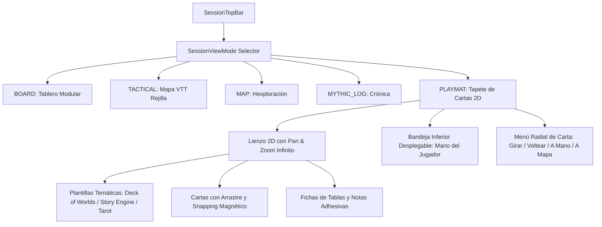

# Especificación Arquitectónica: Tapete de Cartas y Cartografía Física 2D (Playmat)

**Fecha:** 19 de octubre de 2026  
**Estado:** Aprobado en proceso /grill-me  
**Alcance:** DeckApp Android (`app`) & DeckApp Desktop (`TDAPP-desktop`) — Paridad Mandatoria  

---

## 1. Visión General y Objetivos
Transformar la experiencia de la mesa de juego de DeckApp incorporando una **Vista Principal Dedicada: Tapete de Cartas (Playmat)** (`SessionViewMode.PLAYMAT`).
Esta vista complementa al Tablero Modular (Dashboard) y al Mapa Táctico VTT con un lienzo espacial 2D continuo con zoom y pan infinito, optimizado para:
- Despliegue táctil y analógico de cartas.
- Ensamblado visual guiado de clusters de **The Story Engine** y **Deck of Worlds**.
- Gestión fluida entre cartas en mesa, mano privada inferior y descarte.
- Inserción de notas adhesivas (sticky notes), oráculos y tiradas de tablas.
- Conexión bidireccional con el Mapa Táctico (enviar cartas como tokens/POIs).



---

## 2. Modelo de Datos y Persistencia

### A. Nuevos Enums y Modelos en `core:model`
```kotlin
package com.deckapp.core.model

import kotlinx.serialization.Serializable

/**
 * Modos de vista central disponibles en la sesión.
 */
enum class SessionViewMode {
    BOARD,
    TACTICAL,
    MAP,
    MYTHIC_LOG,
    PLAYMAT // NUEVO: Tapete de cartas espacial 2D
}

/**
 * Representa una superficie o mesa de juego dentro de la sesión.
 */
@Serializable
data class PlaymatSurface(
    val id: String = java.util.UUID.randomUUID().toString(),
    val name: String = "Mesa Principal",
    val backgroundTheme: PlaymatTheme = PlaymatTheme.FELT_GREEN,
    val customImageUri: String? = null,
    val template: PlaymatTemplateType = PlaymatTemplateType.FREEFORM,
    val cameraX: Float = 0f,
    val cameraY: Float = 0f,
    val cameraZoom: Float = 1f,
    val cards: List<PlaymatCardPlacement> = emptyList(),
    val stickyNotes: List<PlaymatStickyNote> = emptyList(),
    val tableChips: List<PlaymatTableChip> = emptyList()
)

@Serializable
enum class PlaymatTheme {
    FELT_GREEN,
    FELT_RED,
    RUSTIC_WOOD,
    PARCHMENT_LEATHER,
    DARK_MINIMAL
}

@Serializable
enum class PlaymatTemplateType {
    FREEFORM,
    DECK_OF_WORLDS_MICROSETTING,
    STORY_ENGINE_PREMISE,
    TAROT_THREE_CARDS,
    ORACLE_CROSS
}

@Serializable
data class PlaymatCardPlacement(
    val cardId: Long,
    val x: Float,
    val y: Float,
    val rotationDegrees: Int = 0, // 0, 90, 180, 270
    val zIndex: Int = 0,
    val isFaceUp: Boolean = true,
    val isPinned: Boolean = false,
    val clusterId: String? = null,
    val slotTag: String? = null // Ej: "REGION", "LANDMARK", "ORIGIN", etc.
)

@Serializable
data class PlaymatStickyNote(
    val id: String = java.util.UUID.randomUUID().toString(),
    val text: String,
    val colorHex: String = "#FFF59D", // Amarillo pastel por defecto
    val x: Float,
    val y: Float,
    val rotationDegrees: Float = 0f
)

@Serializable
data class PlaymatTableChip(
    val id: String = java.util.UUID.randomUUID().toString(),
    val tableId: Long,
    val tableName: String,
    val rollResultText: String,
    val x: Float,
    val y: Float
)
```

### B. Persistencia en `Session.kt` y `BoardMemory`
- Añadir a `Session`:
  - `playmatSurfacesJson: String = "[]"`
  - `activePlaymatSurfaceId: String? = null`
- Integración automática con copias de seguridad `FullBackupDto`.

---

## 3. Arquitectura de Interfaz y Gestos (Compose)

### A. Componentes en `feature:draw`
1. **`PlaymatCanvasView.kt`**:
   - Lienzo principal que implementa gestos de puntero múltiple (`pointerInput` con `detectTransformGestures` y `detectTapGestures`).
   - Soporte de renderizado por capas:
     1. Fondo texturizado / Rejilla.
     2. Guías visuales de plantilla temática (siluetas de ranuras cardinales).
     3. Fichas de tablas y notas adhesivas.
     4. Cartas colocadas con elevación, sombra y rotación física.
     5. Menú radial emergente en carta seleccionada.
     6. Mini-mapa / Radar de navegación en esquina inferior derecha.
2. **`PlaymatHandTray.kt`**:
   - Bandeja inferior acoplable/desplegable con pestañas de ordenación y contador de cartas en reserva.
   - Arrastre desde la mano hacia el tapete (drop to table) y botón rápido de "Bajar a Mano".
3. **`PlaymatRadialMenu.kt`**:
   - Menú circular flotante al pulsar una carta:
     - 🔄 **Rotar (1d4 / 1d2)**: Gira la pista activa al borde inferior.
     - 👁️ **Voltear**: Alterna entre frente y dorso oficial.
     - 📥 **A Mano**: Retira la carta del tapete y la devuelve a la mano privada.
     - 🗑️ **Descartar**: Envía la carta a la pila de descarte con animación.
     - 🗺️ **A Mapa Táctico**: Convierte la carta en un token/marcador de mapa.
     - 🔍 **Detalle**: Abre la visualización ampliada en pantalla completa.
4. **`PlaymatTemplateOverlay.kt`**:
   - Renderiza las siluetas magnéticas para *Deck of Worlds* y *Story Engine*. Cuando una carta se arrastra a menos de 40dp de una ranura coincidente, se activa un halo de imán y se auto-acopla.

---

## 4. Plan de Integración en Fases

### Fase 1: Core Playmat & Persistencia (Lienzo 2D + Mano + Drag & Drop)
- Implementar `SessionViewMode.PLAYMAT` en `SessionTopBar`, `SessionScreen` y `SessionViewModel`.
- Crear `PlaymatCanvasView` con Pan, Zoom, Arrastre 2D libre y bandeja de mano inferior.
- Implementar `PlaymatRadialMenu` (Rotar, Voltear, A Mano, Descartar, Detalle).
- Persistencia reactiva del estado del tapete en `Session`.

### Fase 2: Plantillas de Story Engine & Snapping Magnético
- Molde de *Deck of Worlds* (Región + 5 satélites).
- Molde de *Story Engine* (Agente, Trasfondo, Conflicto, Objeto).
- Vinculación con `StoryEngineProcedureBar`: al pulsar "Robar Carta", la carta se ubica automáticamente en el molde activo del tapete.

### Fase 3: Fichas de Oráculo, Notas y Conexión con Mapa Táctico
- Drag & Drop de tiradas de tablas aleatorias y notas adhesivas al tapete.
- Acción "Enviar a Mapa Táctico" que crea un Token con la ilustración de la carta.
- Selector de temas y texturas de fondo (Fieltro, Madera, Pergamino, Dark).
- Exportación del tapete como imagen PNG (Snapshot).

### Fase 4: Paridad con Desktop (`TDAPP-desktop`)
- Trasladar los mismos modelos, esquemas de persistencia y vistas en Compose Desktop.
- Soporte para atajos de teclado y rueda del ratón (Scroll = Zoom, Click derecho = Menú radial / Contextual).

---

## 5. Criterios de Aceptación
1. El usuario puede alternar fluidamente a la pestaña "Tapete" desde la barra superior de la sesión.
2. Las cartas se arrastran sin tirones (60 FPS) y se guardan inmediatamente en la base de datos de la sesión.
3. El menú radial responde al primer toque y permite rotar pistas y voltear cartas instantáneamente.
4. Al jugar con Story Engine, las cartas se acoplan visualmente al molde de microsetting con orientaciones legibles.
5. Los unit tests de delegado cubren adición, movimiento, rotación y descarte en el tapete.
